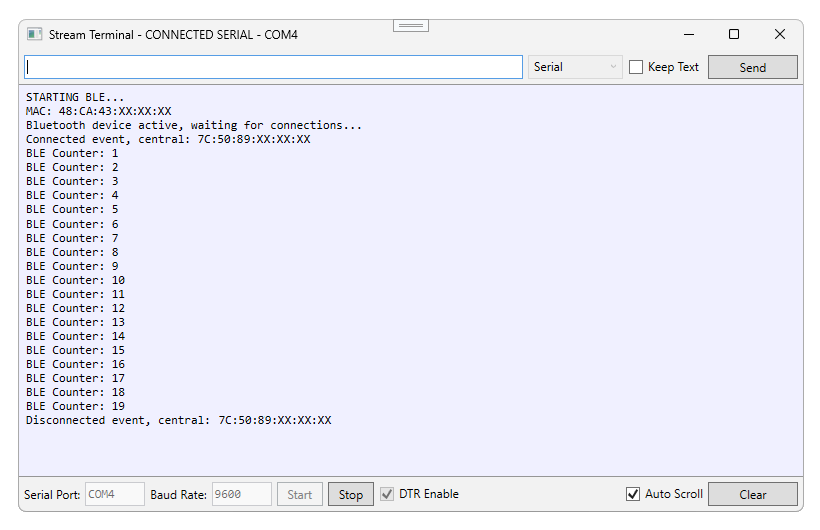
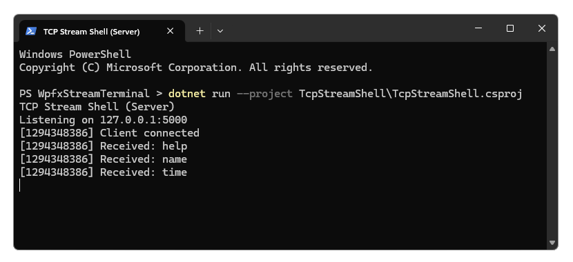
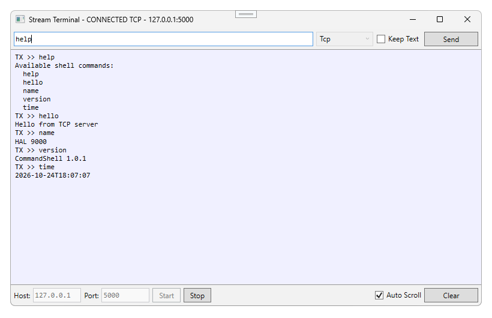
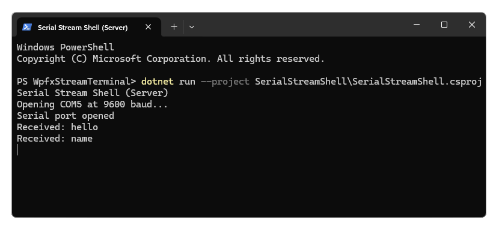
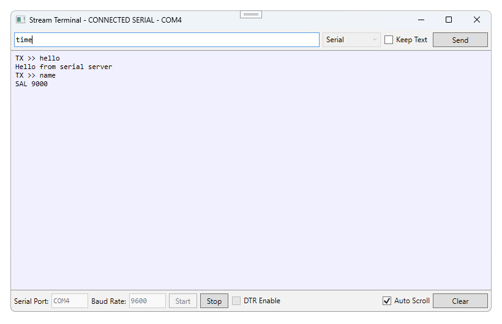

# Stream Terminal

A WPF terminal application built **entirely in C#** with WPFX.

Use it to connect to a serial device or TCP stream.


## `MainWindow`

Select **Serial** or **TCP** protocol from the `ComboBox` on the top row.

The top row also contains an input `TextBox` where you can type and send a command line. 

The large middle row shows the console output, including sent and received text.

The connection settings for the selected protocol appear in the controls on the bottom row, including the **Start** button which is used to open the communications stream.

The window title text shows the connection status.

#### Other controls:
- **Keep Text** leaves your last command in the input `TextBox` after sending it so you can quickly resend the same command.
- **Auto Scroll** keeps the newest output in view.
- **Clear** clears the text shown in the console output.
- **Start** connects to the stream using the current protocol and settings.
- **Stop** disconnects the stream.

The protocol settings are disabled while connected. Stop the connection first if you want to change a setting or switch protocol.

> Stream Terminal communication links are unencrypted and are intended for demonstration purposes only.


## Serial comms demo

The image below shows the Stream Terminal operating using the **Serial** protocol, connected to COM4 and receiving debug trace output from an Arduino R4 device.



> The `SerialPort` setting `DTR Enable = true` is required for correct communication with the Arduino R4 device.

To communicate with your own serial device, connect it to your computer and find its COM port in Windows Device Manager under **Ports (COM & LPT)**. 

In the top row of the Stream Terminal window, choose **Serial** as the protocol.

On the bottom row, enter the device's COM port and baud rate, then click **Start**. 

The WPF app uses 8 data bits, no parity, and 1 stop bit (8-N-1).

If your device accepts commands, type a command line into the input `TextBox` on the top row and then press **Enter** or click **Send**. 

The Stream Terminal sends the command text followed by a carriage return character (`\r`).

The console output area displays the command you sent marked with `TX >>` and the reply from the stream server.

All text lines sent from the stream server are terminated by a line feed character (`\n`) for correct reception and display to the console output area. 

**Line termination (VT100-style):**
- Client → Server: `line` + `CR`
- Server → Client: `line` + `CR` + `LF`

Check your device documentation for its command syntax and communication settings.


## Appendix: Sample servers

The solution includes sample console server applications, each containing a command interpreter _shell_, for testing the Stream Terminal without requiring a physical hardware device such as an Arduino or other embedded system.

### [1] TCP stream shell (server)

`TcpStreamShell` is a console application that acts as a command interpreter running on your local computer as a server listening on `127.0.0.1:5000`.

#### 1.1 Run the TCP stream shell

Open a Windows Terminal in the solution root directory and run:

```powershell
dotnet run --project TcpStreamShell\TcpStreamShell.csproj
```

Alternatively, start the server from Visual Studio:

1. In Solution Explorer, right-click `TcpStreamShell`.
2. Select **Debug > Start Without Debugging**.

Leave the TCP server running.




#### 1.2 Run the Stream Terminal app and connect to TCP
Start the Stream Terminal app from Visual Studio or by running the WPF app EXE file.

Select the **TCP** protocol.

Set **Host** to `127.0.0.1` and **Port** to `5000`, then click **Start**.

Type a command into the input `TextBox` at the top and press **Enter** or click **Send**.

The available commands are: 
- `help`
- `hello`
- `name`
- `version`
- `time`

Click **Stop** to close the TCP connection, ending the stream.



---

### [2] Serial stream shell (server)

`SerialStreamShell` is a console application that acts as a command interpreter running on your local computer connected to a serial COM port.

> **Hardware requirements**
> - Two USB-to-serial adapter cables
> - A null-modem cable to connect the two adapters

For example, with two USB serial adapter cables attached to your computer, you will have two COM ports:
- `COM5` — the USB serial port used by `SerialStreamShell`
- `COM4` — the USB serial port used by `WpfxStreamTerminal`

You can even run the `SerialStreamShell` on another computer.

The null-modem connection crosses the serial comms signals: transmit (TX), receive (RX), and flow-control pins, so that each side can talk to the other.

The serial stream shell COM port and baud rate are set in `SerialStreamShell\Program.cs`. The default settings use **COM5** at **9600 baud**.

Both sides need matching serial settings. The sample uses 8 data bits, no parity, and 1 stop bit (8-N-1).

Change the COM port and other settings in the source code to suit your system setup.

#### 2.1 Run the serial stream shell
Open a Windows Terminal in the solution root directory and run:

```powershell
dotnet run --project SerialStreamShell\SerialStreamShell.csproj
```

Alternatively, start it from Visual Studio:

1. In Solution Explorer, right-click `SerialStreamShell`.
2. Select **Debug > Start Without Debugging**.

Leave the serial server running.




#### 2.2 Run the Stream Terminal app and connect to Serial
Start the Stream Terminal app from Visual Studio or by running the WPF app EXE file.

Select the **Serial** protocol, enter the app-side COM port name and baud rate, then click **Start**.

The Stream Terminal app can then communicate directly with the serial stream shell.

Type a command into the input `TextBox` at the top and press **Enter** or click **Send**.

The available commands are:
- `help`
- `hello`
- `name`
- `version`
- `time`

Click **Stop** to close the serial connection, ending the stream.


